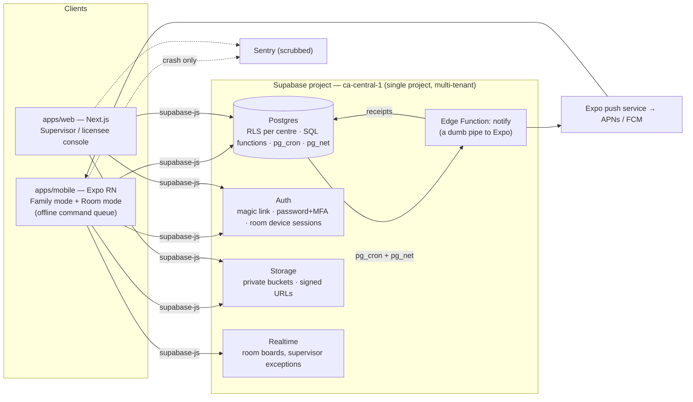

# 01 — Overview and architecture

*The entry point. What Tucked is, why it exists, how it is put together, what it costs to run, and where the architecture is thin.*

---

## The six documents

| # | File | What it covers |
|---|---|---|
| **01** | **this file** | Product, business case, architecture, stack, auth, environments, cost model |
| 02 | [02-features-daily-care.md](02-features-daily-care.md) | Everything about a child's day: attendance, care log, sleep, outdoor, meals, illness, medication, accidents, serious occurrences, the daily written record |
| 03 | [03-features-records-and-obligations.md](03-features-records-and-obligations.md) | Everything that must be *on file*: children's records, consent, immunisation, plans, staff files, policies, handbook, waiting list, fees, premises documents, the compliance calendar |
| 04 | [04-data-security-and-platform.md](04-data-security-and-platform.md) | Schema conventions, RLS, the PIN model, audit, retention, storage, break-glass, the platform/billing layer, push delivery, testing |
| 05 | [05-apps-and-design-system.md](05-apps-and-design-system.md) | Every screen on both apps, the offline model, and the complete design language |
| 06 | [06-gaps-risks-and-roadmap.md](06-gaps-risks-and-roadmap.md) | What is **not** built, what is fragile, what needs a human, and what to do next |

Every file carries its own **"Where this is weak"** sections. Criticism is not quarantined in file 06 — file 06 is the consolidated register and the ordered backlog.

**If you read one thing before writing code, read [06](06-gaps-risks-and-roadmap.md).** It is faster to learn that the airplane-mode runbook has never been run on a device than to discover it in a pilot.

---

## 1. What Tucked is

A compliance-first daily-operations app for **licensed child care centres in Ontario, Canada**, built by PaperKite. Native-mobile-first for families and room staff; a web console for supervisors and licensees.

The two sentences the whole product answers to:

> **Calm for parents. Boring inspections for operators.**

If a change serves neither, it probably belongs on the do-not-build list in [06 §1](06-gaps-risks-and-roadmap.md).

### The product thesis

Competitors (Brightwheel, Procare, Lillio, Playground, Storypark) compete on *engagement*: photo feeds, activity streams, parent messaging, badges. That produces two failures at once —

1. **Parents get noise.** Twenty notifications a day means the one that matters (your child was sent home unwell) arrives in the same channel as a photo of finger paint. The important message is structurally indistinguishable from the trivial one.
2. **Operators still fail inspections**, because the engagement layer does not produce the records O. Reg. 137/15 actually demands, and the records it does produce are editable, deletable, and dependent on the subscription being current.

Tucked inverts both:

- **Quiet by default.** One story per child per day. A hard two-channel split — **Now** (interrupts, requires acknowledgement) and **Later** (never interrupts, batched) — with the routing table in code and unit-tested, so "what is urgent" is a product decision that can be shown to a supervisor, not an accident of implementation.
- **Compliance enforced in the database.** Not in a form validator, not in a client, not in a code review checklist — in Postgres constraints, triggers, RLS policies, and `SECURITY DEFINER` RPCs, proven by 750 pgTAP tests. A client bug cannot produce an invalid regulated record because the client is not what decides.

### Who uses it

| Actor | Surface | Typical session |
|---|---|---|
| **Family adult** (parent, guardian, grandparent) | Expo app, Family mode | 30 seconds at pickup: today's story, any Now alert, one message |
| **Educator / RECE** | Expo app, Room mode on a shared tablet | All day: sign-in, care logs, sleep checks, headcounts, evacuation |
| **Supervisor** | Web console + Expo app | Morning exceptions, closing the daily written record, filing a serious occurrence |
| **Licensee / admin** | Web console | Fees, handbook, policies, staff files, premises documents |
| **Program advisor (Ministry)** | Nothing of their own — reads over a supervisor's shoulder, or through break-glass | Inspection day: the register, the daily records, the staff files |
| **Platform admin (PaperKite)** | `/admin` | Create a centre, set a plan, record a payment. **Never sees a child.** |

### Positioning against the market

| Capability | Competitors | Tucked |
|---|---|---|
| Photo/activity feed | The core product | Present, deliberately quiet, one story a day |
| Parent messaging | Heavy | Present, thread-scoped, no attachments |
| Billing | Card processing, parent-side fees common | **Records money, never moves it.** No parent-side payment fee, ever |
| Compliance records | An export feature | **The product.** Every regulated write is append-only and machine-proven |
| CWELCC cap enforcement | Not modelled | Enforced in the database; a fee above the cap cannot be saved |
| Offline | Rare or partial | Room mode is offline-*first*; the evacuation screen never touches the network |
| "Not today" / "running late" from the parent | Standard (Playground, Brightwheel, Procare) | Built (0040): a notice explains an absence for s. 50 safe arrival, never writes to the legal register, and a broken "running late" puts the child back on the chase list |
| Marketing website builder | Sold as an upsell | **Won't build** |
| Ratio engine | Usually a display | Pure functions, 21 tests, runs identically offline and in the database |

### Standing orders

These come from the founder and override convenience:

1. **Super low running costs.** Near-zero until a pilot centre exists (§8).
2. **Data in Canada.** Every byte — Postgres, Storage, function execution — in `ca-central-1`. A brand promise, not a setting.
3. **Compliance enforced in the database**, not in clients.
4. **Quiet by default.**
5. **No third-party analytics or advertising SDK anywhere near children's data.** Ever.
6. **Nothing is auto-filed with a regulator.** Tucked prepares, reminds, and holds the evidence; a human submits.
7. **Regulated records are never deletable** — not by a lapsed subscription, not by a support request, not by a platform admin.

---

## 2. Constraints that shape everything

1. **Compliance is the product.** Records must be impossible to lose, available on premises including offline, retained 3–6 years, and exportable by regulation section. This is what pushes logic into the database: a rule enforced by a Postgres constraint survives a client bug, a bad deploy, and a rushed developer.
2. **Solo founder, second product.** Every component must be managed, boring, and need zero ops attention in the steady state. No servers to patch, no clusters, no queues to babysit.
3. **Super low running costs.** §8 is the budget; the architectural consequences are marked **[cost]** throughout.
4. **Data residency in Canada.**
5. **Real native apps.** The Now channel must be dependable on iPhones; room tablets need camera, offline storage and long sessions. Web push on iOS is not dependable enough to bet a sick-child alert on.

---

## 3. System overview



**Tenancy is rows, not infrastructure.** One Supabase project serves every centre. Every table carries `centre_id`; RLS enforces isolation in the database; pgTAP proves it for every role including "wrong centre", "removed household member" and "restricted pickup person".

**[cost]** This is the single largest cost decision in the system. Per-tenant projects or servers multiply the floor cost by the number of centres. Per-tenant *rows* cost nothing.

### Where this is weak

- **One project is also one blast radius.** A bad migration touches every centre at once. There is no staging project (§7) and no per-tenant rollback. Mitigation today is entirely pgTAP plus `supabase db reset` locally; that is real but it is not a second environment.
- **No read replica, no connection pooling story at scale.** Fine at 10 centres, unexamined at 200.
- **Realtime is in the diagram and barely used.** Room boards poll rather than subscribe in most places. Not a bug, but the architecture claims more liveness than the code delivers.

---

## 4. The monorepo

pnpm workspaces + Turborepo, TypeScript strict everywhere.

```
apps/
  mobile/          Expo SDK 57, Expo Router. One binary, two modes:
                   Family (household adults) and Room (educators, PIN-locked).
  web/             Next.js 16 App Router. Supervisor & licensee console,
                   the public waiting-list page, and /admin.
                   Plain CSS + custom properties from ui-tokens.
                   No Tailwind, no CSS-in-JS.
packages/
  domain/          Pure TypeScript. Zod schemas, the Ontario rule engine
                   (ratios, age groups, retention clocks, notification
                   routing, safe arrival, the story builder), province and
                   room presets, i18n (en-CA live, fr-CA scaffolded).
                   No React, no Supabase imports. 90 tests.
  ui-tokens/       Design tokens: a TypeScript face for React Native
                   StyleSheet and a CSS face for the web. 60 tests.
supabase/          38 migrations, RLS policies, SQL functions, the notify
                   Edge Function, pg_cron schedules, the seed generator,
                   32 pgTAP suites (750 tests).
docs/              compliance-map.md, compliance-test-report.md,
                   decisions.md, demo-script.md, plans/
references/        These six documents.
```

**Why `packages/domain` is pure:** the same ratio calculation must run on a room tablet with no network, in a test fixture, and against seeded data. Purity makes it portable and makes the branch-coverage gate cheap. Every rule test is named for its regulation section (`s8_volunteer_never_counted_in_ratio`).

### Where this is weak

- **`packages/domain` is smaller than it looks.** Ratios, age groups, retention and notification routing are genuinely there and well tested. Most other rules live only in SQL — which is the right call for enforcement, but it means the "portable rule engine" story is narrower in practice than the architecture implies. A client cannot pre-check most refusals; it discovers them from an error message.
- **Two faces of one schema can drift.** `careLogSchemas.ts` and `app.validate_care_log_payload` are supposed to mirror each other. They did not: `position` was an enum in TypeScript and unvalidated in SQL for the whole life of the project until migration 0038. There is still no test that compares the two mechanically.

---

## 5. Stack decisions

Recorded so they are not relitigated.

| Decision | Choice | Rejected | Why |
|---|---|---|---|
| Mobile | **Expo (React Native)** | Capacitor, PWA, native Swift/Kotlin | Dependable push on iOS; real store listing; EAS Build in the cloud (no Mac needed); EAS Update ships JS fixes without store review. Capacitor gives a webview feel plus thin-wrapper rejection risk. |
| Backend | **Supabase, `ca-central-1`** | MongoDB Atlas, Firebase, self-hosted Postgres | Compliance data is relational (child × room × day × record type). RLS puts tenancy in the database. Auth + Storage + Realtime + Functions built in. Firebase cannot promise Canada for every service; Mongo cannot do RLS. **[cost]** one flat bill. |
| Web console | **Next.js App Router** | Remix, plain SPA | Server components keep the console light; exports render server-side. |
| Styling | **Tokens + StyleSheet / plain CSS** | Tailwind, NativeWind, CSS-in-JS | One token file drives both platforms; no runtime styling cost. |
| Push | **Expo push service** | raw APNs/FCM, OneSignal | Free, both platforms, no extra vendor. **[cost]** |
| Payments (P2) | **Stripe Canada** — cards + pre-authorised debit (ACSS/PAD) | Moneris, custom | PAD is the fee-free-for-parents rail. e-Transfer has no receiving API anywhere, so record-and-reconcile against per-invoice reference codes is the honest design. **Parents never pay a fee.** |
| Observability | **Sentry free tier + structured logs** | Datadog et al. | Enough for one operator. PII scrubbed: no request bodies, no child names. **[cost]** |
| AI (P2, optional) | **Anthropic API**, Haiku-class | — | Drafts only. **Never** touches accident reports, serious occurrences, medication, or the daily written record. |

---

## 6. Where logic lives

Three layers with strict rules about what goes where.

### Layer 1 — Postgres: anything that *must be true*

Constraints, triggers, `SECURITY DEFINER` functions, RLS policies, `pg_cron`, `pg_net`.

- `depart` requires a same-day `arrive`; `actual_time` is NOT NULL; corrections reference the original row.
- A `pickup_restriction` blocks sign-out at SQL level.
- An excluded child cannot be signed in (s. 36).
- A base fee above the CWELCC cap cannot be stored.
- A child under 12 months cannot be recorded as placed for sleep on anything but their back without a physician's written direction on file.
- Regulated tables are append-only-with-corrections. **No subscription state, lapsed plan or lost password ever deletes or hides a row.**
- `audit_event` is append-only on every regulated write — references only, never photos or free-text health details.

**The write model:** clients never `INSERT` into a regulated table. They call a `SECURITY DEFINER` RPC that verifies a staff PIN and resolves *who* is recording. RLS grants `SELECT` and nothing else on those tables. This is why "the PIN is who logged it" holds even on a shared tablet.

### Layer 2 — Edge Functions: things needing the service role

Exactly one exists today: `notify`, a deliberately dumb pipe to Expo (§04). *Which* notifications get pushed is a product promise that lives in the database as `app.notifications_to_push`, where pgTAP can hold it to account.

### Layer 3 — Clients: presentation, capture, the offline queue

Clients pre-validate with the shared Zod schemas for good UX, but the database re-enforces everything. **Client validation is a courtesy, not a defence.**

**[cost]** There is deliberately no fourth layer: no API server, no background-job service, no Redis, no message queue. `pg_cron` is the scheduler. The queue for offline writes lives on the device.

### The scheduled jobs

| Job | Cadence | What it does |
|---|---|---|
| `daily-record-drafts` | `5 * * * *` | Creates the day's written-record draft at 06:00 centre-local |
| `push-dispatch` | `*/2 * * * *` | Calls the notify function through `pg_net` |
| `push-ticket-sweep` | `25 3 * * *` | Closes push tickets whose receipt never came back |
| `retention-sweep` | `30 2 * * *` | Anonymises children's records past their clock |
| `waitlist-sweep` | `45 2 * * *` | Anonymises waiting-list entries 12 months after closing |
| `financial-sweep` | `50 2 * * *` | Redacts CRA receipts at six years |
| `serious-occurrence-clock` | `15 * * * *` | 24-hour CCLS reminders and overdue notices |
| `public-health-clock` | `20 8 * * *` | Program-advisor forwarding deadlines |

### Where this is weak

- **`pg_cron` failures are silent.** If a job errors, nothing pages anybody. `stuck_push_alerts` covers the push path specifically, but there is no general "a sweep did not run last night" signal.
- **Cron cadence is centre-agnostic.** The daily-record job runs hourly and picks centres whose local 06:00 has passed — correct, but it means a centre in a timezone the seed does not anticipate gets its draft late rather than loudly wrong.
- **One Edge Function is a thin deployment story.** `notify` must be deployed manually per environment with a shared secret, and there is no health check that says "the function exists". Until it is deployed the dispatcher returns `not configured` — honest, but discoverable only by looking.

---

## 7. Auth, roles and environments

### Actors and methods

| Actor | Method | Notes |
|---|---|---|
| Family adults | Email magic link (optional phone OTP) | **Per-person accounts inside a household — never a shared login.** Per-person permissions: view, message, pickup, consent, billing. Individually revocable. |
| Staff | Email + password; **MFA for supervisor/licensee** | |
| Room mode | Device session bound to the centre + **4–6 digit staff PIN on every regulated write** | The PIN is *who logged it*. Shared tablet, individual accountability. |
| Platform admin | Email + password | Holds no care role, so RLS never shows them a child. |
| Ministry access | s. 82(2): staff and officials must **always** be able to get in | Hence break-glass (§04) and an evacuation screen outside authentication. There is never a screen that says "contact your admin to unlock attendance". |

The per-person household permission model exists because of a specific competitor failure: a shared household login means a co-parent who should no longer have access cannot be removed without locking out the other. Here, `household_member` rows are revoked individually and the effect is immediate at query level.

### Roles

`role_id`: `licensee_admin`, `supervisor`, `designate`, `rece`, `assistant`, `student`, `volunteer`, `family_adult`. Volunteers and students are **never counted in ratio** and cannot record attendance — enforced in SQL and proven by `s8_volunteer_never_counted_in_ratio` and `s8_volunteer_cannot_record_attendance`.

### Environments and CI

- **Local:** the Supabase CLI runs the whole stack in Docker. Free, offline, and the only place migrations are developed. `pnpm db:seed:gen && pnpm exec supabase db reset && pnpm exec supabase test db`.
- **Staging:** does not exist. See "Where this is weak".
- **Production:** `ca-central-1`.
- **CI:** lint, typecheck, domain tests, ui-tokens tests, mobile queue tests. **[cost]** free-tier minutes are enough at solo scale; EAS builds do not run per commit.
- **Mobile releases:** EAS Build with dev/preview/production profiles. JS-only changes ship via EAS Update **[cost]**; native changes batch into rare store builds.
- **Web releases:** Cloudflare Pages free tier — **not Vercel Hobby**, whose terms prohibit commercial use.

### Where this is weak

- **There is no staging environment.** Every migration goes from a laptop to production. The upgrade trigger is named in §8 ("a destructive-migration near-miss, or a second engineer") but the risk is live today.
- **pgTAP does not run in CI.** `pnpm check` covers lint, typecheck and the JS/TS test suites; the 750 database tests are run by hand with `pnpm exec supabase test db`. This is the single biggest gap in the quality story — the most valuable tests in the repo are the ones CI does not run.
- **No migration rollback discipline.** Migrations are forward-only in practice. "Every migration reversible" is an aspiration in the original architecture note, not something the tree demonstrates.
- **`create or replace function` across migrations is a live trap.** Migration 0038 rebuilt `app.care_log_rules()` from the 0006 text and silently dropped an amendment made in 0022, breaking the retention sweep. The suite caught it. Nothing prevents the next occurrence. See [04 §9](04-data-security-and-platform.md).

---

## 8. Cost model

*Prices in USD unless marked CAD, correct as of Aug 2026. **Re-verify before each phase** — tiers move.*

### The shape

1. **Fixed costs ≈ $0 until a pilot centre exists.**
2. **Costs step, never creep.** Each paid tier is adopted only when a named trigger fires.
3. **Revenue outruns cost from centre one.** At roughly CA$6–10/child/month, one 40-child centre ≈ **CA$240–400/mo** — several multiples of the entire infrastructure bill at that stage.

### One-time

| Item | Cost | When |
|---|---|---|
| Google Play developer account | $25 once | First Android internal-testing build |
| Apple Developer Program | $99/yr | First TestFlight build |
| `tucked.ca` (+ `gettucked.ca`) | ~CA$15–20/yr each | Immediately |
| CIPO trademark (classes 42 + 9) + agent opinion | ~CA$500–1,200 | Business decision, not infrastructure |

Fonts cost nothing: Baloo 2 and Nunito are both OFL, embedding included.

### Stage A — development. Target **$0/mo**

Supabase local via CLI plus a free-tier project; Expo EAS free; GitHub free; Sentry Developer; Cloudflare Pages free; Expo push; Supabase built-in email (rate-limited, dev only).

### Stage B — pilot, 2–3 centres. Target **~$25–30/mo**

| Service | Tier | Cost | Trigger that moved it |
|---|---|---|---|
| Supabase | **Pro** | $25/mo | The first real centre's data. No project pausing, daily backups, 8 GB db, 100 GB storage. **Backups are non-negotiable once regulated records exist.** |
| Email | Resend free (3k/mo) via custom SMTP | $0 | Magic links and CWELCC notice delivery need real deliverability |

### Stage C — first 10 paying centres. Target **~$45–70/mo**

Supabase Pro plus usage ($25–40); EAS paid **only if** a release is actually blocked (+$19); Sentry paid **only if** volume genuinely exceeds 5k/mo (+$26); Anthropic API for optional story polish (~$2–5/mo/centre worst case); Stripe per-transaction only, absorbed by the centre's plan and **never charged to parents**.

**Steady-state floor at 10 centres: roughly $50/mo + $99/yr — against ~CA$2,500–4,000/mo revenue at list price. Infrastructure is never the business risk.**

### The two usage costs that could bite

**Photos.** A busy centre: 40 children × 6 photos/week × 48 weeks ≈ 11,500 photos/yr. Client-side re-encode (2560 px long edge, q≈85, EXIF stripped except capture time) ≈ 0.7 MB each → **~8 GB/centre/yr**, inside Pro's 100 GB for the first ~12 centre-years, then ~17¢/mo per centre-year. Egress is controlled structurally: feeds serve thumbnails, originals move only on explicit download. The "full-resolution dated lifetime archive" promise costs pennies *because* the resize-before-upload rule is enforced in the client.

**AI (Phase 2, optional).** Haiku-class story polish: 40 stories/day × ~1,200 tokens ≈ 1.4M tokens/mo ≈ **$3–4/mo per centre**, less with prompt caching. Drafts only, graceful no-AI fallback, never on a hot path.

### Upgrade triggers — the "never just in case" table

| Do not pay for | Until |
|---|---|
| Supabase Pro | The first real centre's data exists |
| A second (staging) Supabase project | A destructive-migration near-miss, or a second engineer |
| EAS paid | A release is actually blocked by the free build queue |
| Vercel Pro | A named Next.js feature Cloudflare cannot serve costs real hours |
| Sentry paid | Sustained legitimate volume past 5k events/mo |
| SMS / phone OTP | A pilot family genuinely cannot use email magic links. **The only optional auth feature with per-use cost — keep it off by default** |
| Any analytics / monitoring / feature-flag SaaS | **Never.** Postgres event counts, a settings table, and `pg_cron` do these jobs |
| Dedicated support tooling | Past ~10 centres, when a shared inbox stops working |

### Engineering rules that keep the bill flat

1. One multi-tenant Supabase project — a new centre is an INSERT.
2. No servers, queues or schedulers outside Postgres + Edge Functions + `pg_cron`.
3. Resize on the client, thumbnail on read, original on demand.
4. EAS Update for every JS-only change.
5. **Postgres before SaaS**: analytics = event counts, search = FTS, flags = a table, audit = an append-only table, cron = `pg_cron`.
6. No per-interaction third-party calls in any daily flow. The only external hot-path service is Expo push, which is free.
7. Local-first development: a full day's work costs $0 and works offline.
8. **Every new vendor needs a line in this file first.** If it cannot name its trigger, it does not get added.

### What we deliberately do not economise on

Backups and a no-pause database the moment real records exist; the Canadian region even if another were cheaper; real store apps; same-business-day human support (founder time, not money).

### Where this is weak

- **The numbers are a model, not a measurement.** No centre has ever run on this. Photo volume in particular is a guess with a plausible shape; a centre that photographs everything could be 3× the estimate and still be cheap, but the model has not met reality.
- **Egress at inspection time is unmodelled.** A program advisor pulling a year of records is a burst nobody has measured.
- **The pricing band (CA$6–10/child/mo) has never been tested with a buyer.** The cost side is conservative; the revenue side is an assumption.

---

## 9. Security and privacy invariants

Architectural, not features:

- **RLS on every table.** pgTAP proves isolation per role, per centre.
- **Minimum collection.** Every optional field is labelled optional; enrolment completes with all optional consents declined (s. 73).
- **No third-party analytics or ad SDKs** in the mobile app. Product analytics come from Postgres event counts — which is also the **[cost]** answer.
- **Crash reporting scrubbed**: no request bodies, no child names, no photos.
- **Retention**: 3 years post-discharge for children's records and attendance, 6 years for financial. Purge means **anonymisation with an audit trail, never a hard delete**, and never early.
- **Data residency**: every byte in `ca-central-1`.
- **No SIN is ever stored.** A licensed centre's CRA receipt carries a business number; we will not put a social insurance number beside a photograph of a child.

Full mechanics in [04](04-data-security-and-platform.md).

---

## 10. Reading the rest

- Want to know **what a feature does in every case**? → [02](02-features-daily-care.md) and [03](03-features-records-and-obligations.md).
- Want to know **why a query returns nothing**? → [04](04-data-security-and-platform.md), especially §5 (RLS) and §9 (recurring bug classes).
- Want to **build a screen**? → [05](05-apps-and-design-system.md).
- Want to know **what will bite you**? → [06](06-gaps-risks-and-roadmap.md).
